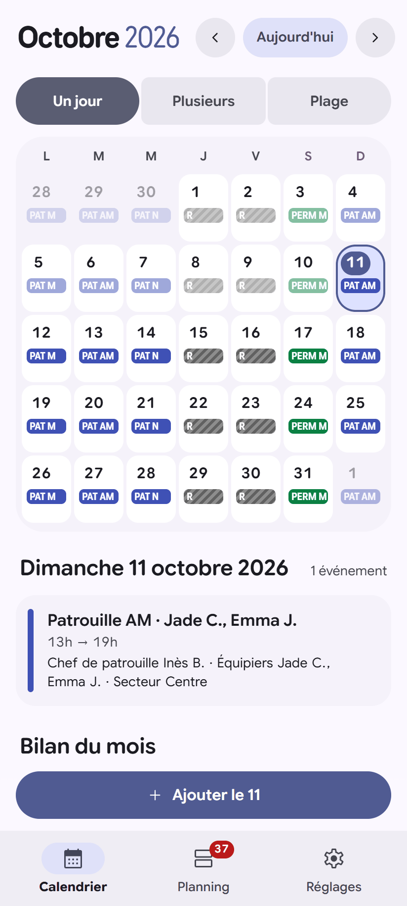
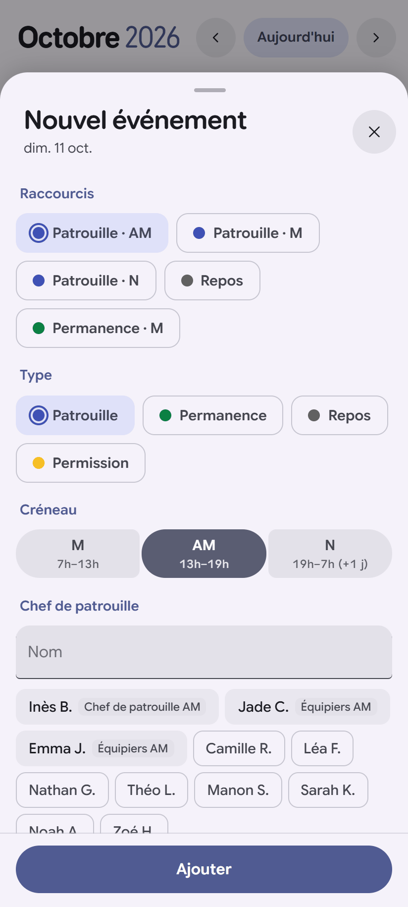
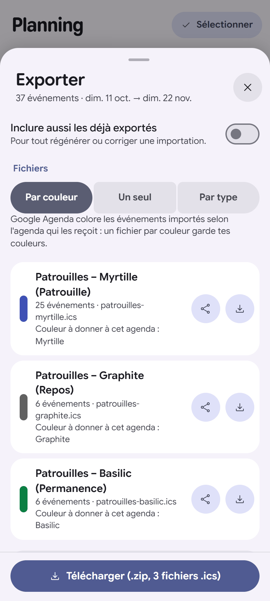
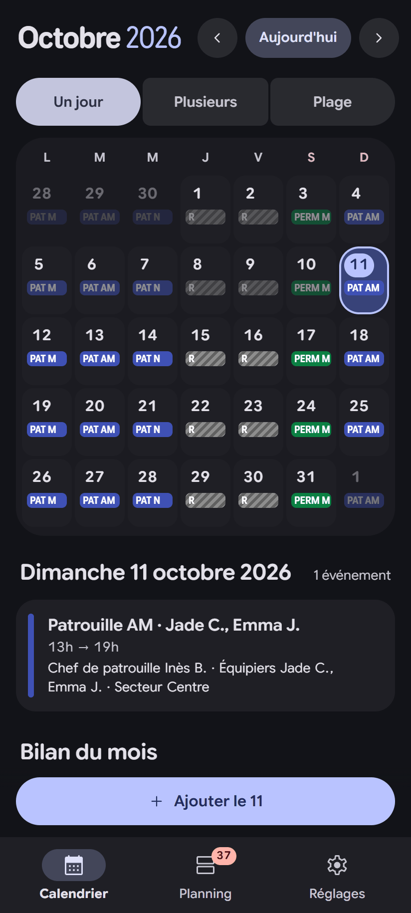

# AgendApp

*[English version](README.md)*

**Un générateur d'agenda pour les plannings qui se répètent.** Tu décris une fois tes créneaux, tes
types d'événements et ce qui change d'une fois à l'autre (personnes, lieu, tâche…). Ensuite, chaque
événement se crée en quelques touches, au lieu de retaper les mêmes horaires dans ton agenda.

Sans compte, sans serveur : tes données restent sur ton appareil. Disponible en français et en anglais.

<p align="center">
  
  
  
  
</p>

> Projet personnel, conçu par un non-développeur avec une IA (voir [Comment ce projet est né](#comment-ce-projet-est-né)).
> Utilisé au quotidien, fourni sans garantie : fais des sauvegardes.

---

## L'idée

Dans un agenda classique, chaque garde, chaque poste, chaque patrouille se saisit à la main : mêmes
horaires, même couleur, mêmes collègues à retaper. AgendApp part de ce qui se répète :

| Tu définis une fois… | …et à chaque événement tu ne choisis que |
|---|---|
| **Créneaux** : Matin 6h–14h, Nuit 22h–6h (le lendemain est géré) | le jour |
| **Types d'événements** : Service, Garde 24 h, Repos, Formation… avec leur couleur, leurs champs, leur titre | le type (et le créneau s'il y en a plusieurs) |
| **Champs** : chef d'équipe, équipiers, lieu, heure de relève… | les valeurs qui changent, avec suggestions |
| **Règles** : « une nuit est suivie d'un repos », « l'équipe de nuit = l'équipe du soir » | rien : c'est proposé ou prérempli |

Exemples d'usages : soignants en 12 h, équipes postées dans l'industrie, sapeurs-pompiers,
patrouilles de sécurité ou de police, armée, conducteurs de bus ou de tram, astreintes, bénévoles,
garde alternée… Des [profils d'exemple fictifs](examples/fr/) permettent d'essayer sans rien saisir.

## Trois façons de s'en servir

1. **Une machine à fabriquer des agendas** : on saisit vite, puis on exporte des fichiers `.ics`
   (un par couleur, par type ou un seul) à importer dans Google Agenda, Outlook, Apple Calendrier…
2. **Un pont vers l'agenda du téléphone** (Android) : envoi direct, sans passer par un fichier ;
   en option, un événement supprimé d'un côté l'est aussi de l'autre.
3. **Un agenda à part entière** : calendrier, planning, bilan des heures, widgets, montre.

## Fonctionnalités

**Partout (ordinateur et téléphone)**
- Calendrier du mois et planning ; saisie sur un jour, plusieurs jours ou une plage ; journées entières.
- Suggestions de noms (personnes déjà prévues ce jour-là, noms récents), champs « collants ».
- Règles de proposition et de préremplissage ; alertes de doublons et de chevauchements.
- Export `.ics` (la réimportation met à jour les événements au lieu de les dupliquer), sauvegarde
  et restauration JSON.
- Bilan des heures du mois et par personne, avec des **règles de calcul** réglables (ce qui compte
  comme heures de service ou comme repos, pause déduite, durée fixe…).
- Transfert entre appareils par QR codes ou code texte, sans serveur.
- Interface en français et en anglais, thèmes clair et sombre.

**Application Android**
- Interface Material 3 Expressive aux couleurs du téléphone (Material You).
- Envoi direct dans l'agenda du téléphone et synchronisation des suppressions.
- Sauvegarde automatique (à chaque modification, chaque jour ou chaque semaine, dossier au choix).
- Verrouillage (empreinte, visage ou code), widgets d'écran d'accueil, raccourcis sur l'icône.

**Montre Wear OS**
- Tuile « en cours / prochain événement », complication avec compte à rebours, et une application
  (à venir, calendrier, détail, heures du mois). Aucune tâche de fond : économe en batterie.

## Installer

Rendez-vous dans les [Releases](../../releases) :

| Fichier | Pour |
|---|---|
| `AgendApp.html` | **Ordinateur** : un seul fichier à ouvrir dans un navigateur (Chrome, Edge, Firefox…). |
| `AgendApp-<version>.apk` | **Téléphone Android**, Android 7 ou plus récent. |
| `AgendApp-wear-<version>.apk` | **Montre Wear OS**, Wear OS 3 ou plus récent (installation par ADB, voir plus bas). |

Les données de la version ordinateur restent dans le navigateur qui l'ouvre : fais une sauvegarde
JSON de temps en temps, et utilise le transfert par QR code pour passer de l'ordinateur au téléphone.

<details>
<summary>Installer l'app montre (Wear OS)</summary>

1. Sur la montre : Paramètres › Système › À propos › touche 7 fois « Numéro de build ».
2. Options pour les développeurs : active **Débogage ADB** et **Débogage via Wi-Fi**.
3. « Associer un nouvel appareil », puis sur l'ordinateur :
   ```sh
   adb pair <ip>:<port-association> <code>
   adb connect <ip>:<port>
   adb install AgendApp-wear-<version>.apk
   ```
L'app téléphone doit être installée : c'est elle qui envoie les événements à la montre.
</details>

## Vie privée

- Aucun compte, aucune publicité, aucune statistique d'usage, aucun serveur.
- Les données restent sur l'appareil ; les sauvegardes vont où tu le décides.
- La montre reçoit une copie limitée (une semaine passée, trois mois à venir) par la liaison
  Wear OS entre tes appareils.

## Compiler

Prérequis : Node.js 20+ ; pour Android, JDK 17+ et le SDK Android 35.

```sh
cd web
npm install
npm run build          # interface : web/dist/AgendApp.html + android/app/src/main/assets/www
cd ../android
./gradlew assembleDebug   # app/ (téléphone) et wear/ (montre)
```

Autres commandes : `npm run check:i18n` (vérifie les traductions), `npm run examples` (régénère les
profils d'exemple), `npm run screenshots` (captures de la documentation, avec Chrome, Edge ou Brave).

## Organisation du code

```
web/                       Interface (Preact + JavaScript), commune à l'ordinateur et à Android
├── src/lib/               Logique sans interface : modèle, dates, règles, heures, export .ics, transfert…
├── src/screens/           Écrans : Calendrier, Planning, Réglages et leurs feuilles
├── src/ui/                Composants (boutons, listes, feuilles, icônes Material Symbols)
├── src/i18n/              Traductions : en.js (référence) et fr.js
├── src/platform/android/  Pont vers l'app Android (Material You, agenda, sauvegarde, widgets…)
├── src/styles/m3.css      Habillage Material 3 Expressive
├── build.mjs              Construction (version ordinateur, assets Android, icônes)
└── scripts/               Profils d'exemple, captures d'écran, vérification des traductions
android/
├── app/                   App Android (Kotlin) : WebView, agenda, sauvegarde, widgets, biométrie
└── wear/                  App montre (Kotlin, Compose Material 3) : app, tuile, complication
examples/                  Profils fictifs à importer (anglais ; français dans examples/fr)
docs/screens/              Captures d'écran
```

Toutes les données tiennent dans un seul objet JSON, décrit en tête de
[`web/src/lib/model.js`](web/src/lib/model.js). Les commentaires du code sont en anglais.

### Ajouter une langue

1. Copie `web/src/i18n/en.js` dans un nouveau fichier (par exemple `de.js`) et traduis les valeurs.
2. Déclare-le dans `web/src/i18n/index.js` (`CATALOGS` et `LANGUAGES`).
3. Lance `npm run check:i18n`.
4. Pour l'app Android et la montre, ajoute `values-<code>/strings.xml` à côté des fichiers existants.

## Comment ce projet est né

AgendApp a d'abord été un fichier HTML écrit pour un besoin personnel : saisir vite des plannings
de service répétitifs et les envoyer dans un agenda. Il est ensuite devenu une application Android,
puis une app montre.

**L'auteur n'est pas développeur.** Tout le code a été écrit en dialogue avec
[Claude Code](https://www.anthropic.com/claude-code), l'assistant de programmation d'Anthropic :
l'auteur a décrit ses besoins, testé sur ses appareils et fait les choix ; l'IA a conçu et écrit le
code. Concrètement :

- les fonctionnalités viennent d'un usage réel, testé au quotidien sur téléphone et montre ;
- le code n'a pas (encore) été relu par un développeur humain ;
- un banc de comparaison automatique a servi à vérifier que la réécriture lisible du code se
  comporte exactement comme la version d'origine, mais il n'y a pas encore de tests unitaires.

Les relectures, signalements et contributions sont donc particulièrement bienvenus.

## Contribuer

- **Retour d'usage** : ouvre une [issue](../../issues) en décrivant ton métier et le
  fonctionnement de ton planning (avec des données inventées, jamais de vrais noms).
- **Code** : une issue avant toute grosse modification, merci. Garde le comportement existant et
  décris comment tu as testé.
- Pistes ouvertes : import (texte collé, `.ics`, CSV), tests automatisés, autres langues, version
  installable depuis un navigateur (PWA).

## Licence

[GPL-3.0-or-later](LICENSE). Composants tiers : Preact (MIT), jsQR (Apache 2.0), qrcode-generator
(MIT), material-color-utilities (Apache 2.0), Material Symbols (Apache 2.0), Google Sans Flex
(SIL OFL 1.1), bibliothèques AndroidX et Jetpack Compose (Apache 2.0).
