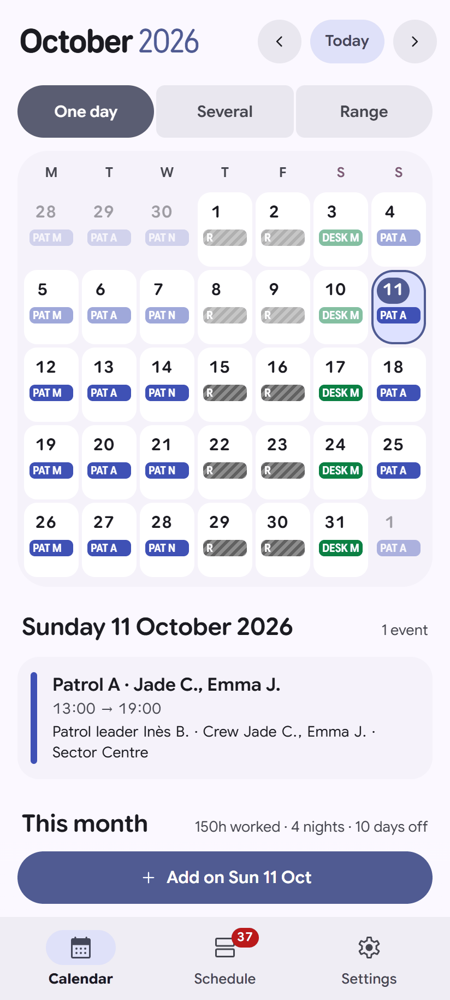
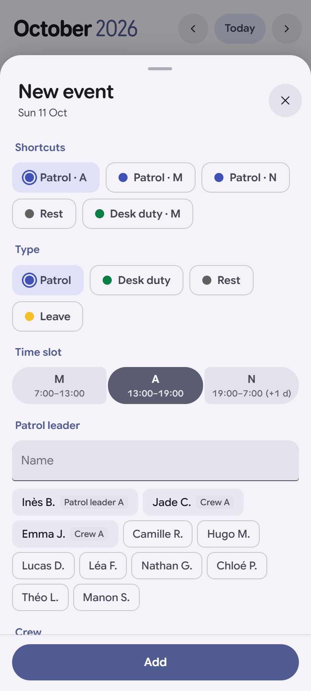
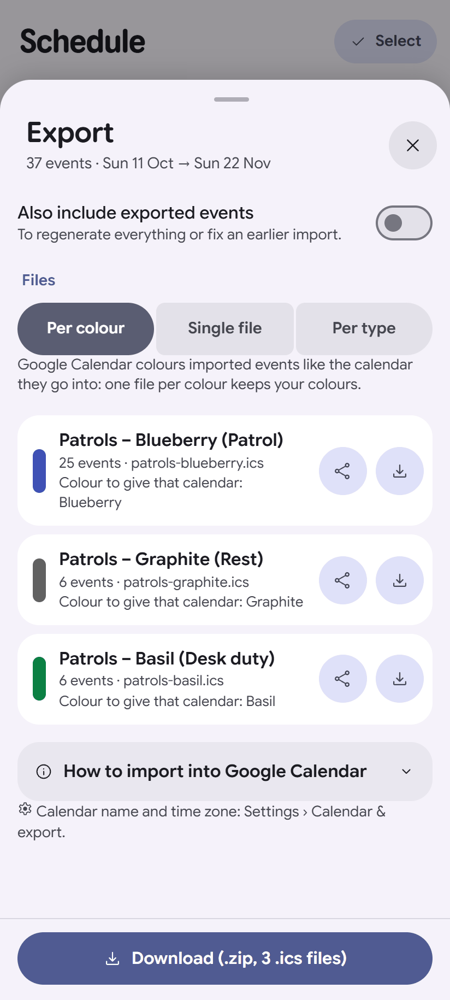
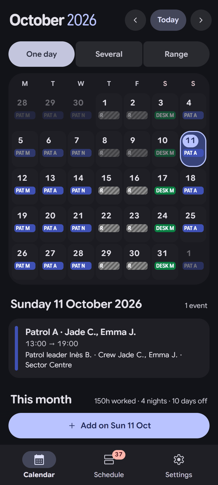

# AgendApp

*[Version française](README.fr.md)*

**A calendar generator for schedules that repeat.** Describe your time slots, your kinds of events
and what changes from one time to the next (people, place, task…) once. After that, each event
takes a couple of taps instead of retyping the same hours in your calendar app.

No account, no server: your data stays on your device. Available in English and French.

<p align="center">
  
  
  
  
</p>

> A personal project, designed by a non-developer with an AI (see [How this project was made](#how-this-project-was-made)).
> Used daily, provided without warranty: keep backups.

---

## The idea

In a regular calendar, every shift, duty or patrol is typed by hand: same hours, same colour, same
colleagues every time. AgendApp starts from what repeats:

| You define once… | …and for each event you only pick |
|---|---|
| **Time slots**: Morning 6:00–14:00, Night 22:00–6:00 (ending the next day is handled) | the day |
| **Event types**: Shift, 24-hour duty, Rest, Training… with their colour, fields and title | the type (and the slot if there are several) |
| **Fields**: team leader, team members, place, handover time… | the values that change, with suggestions |
| **Rules**: "a night shift is followed by a rest day", "the night team is the evening team" | nothing: it is suggested or prefilled |

Examples of uses: nurses on 12-hour shifts, rotating factory teams, firefighters, security and
police patrols, armed forces, bus and tram drivers, on-call rotas, volunteers, shared custody…
[Made-up example profiles](examples/) let you try it without typing anything.

## Three ways to use it

1. **A calendar factory**: enter events quickly, then export `.ics` files (one per colour, per
   type, or a single file) to import into Google Calendar, Outlook, Apple Calendar…
2. **A bridge to the phone's calendar** (Android): direct sending, no file needed; optionally, an
   event deleted on one side is deleted on the other.
3. **A calendar on its own**: month view, schedule list, hours summary, widgets, watch.

## Features

**Everywhere (computer and phone)**
- Month calendar and schedule list; add on one day, several days or a range; all-day events.
- Name suggestions (people already scheduled that day, recent names), "sticky" fields.
- Suggestion and prefill rules; duplicate and overlap warnings.
- `.ics` export (re-importing updates events instead of duplicating them), JSON backup and restore.
- Monthly and per-person hours summary, with adjustable **counting rules** (what counts as
  worked time or time off, deducted breaks, fixed lengths…).
- Device-to-device transfer with QR codes or a text code, without a server.
- English and French interface, light and dark themes.

**Android app**
- Material 3 Expressive interface in the phone's colours (Material You).
- Direct sending to the phone's calendar and deletion sync.
- Automatic backup (after each change, daily or weekly, to a folder of your choice).
- App lock (fingerprint, face or PIN), home-screen widgets, launcher shortcuts.

**Wear OS watch**
- "Current / next event" tile, complication with a countdown, and an app (upcoming events,
  calendar, details, monthly hours). No background work: easy on the battery.

## Install

Go to [Releases](../../releases):

| File | For |
|---|---|
| `AgendApp.html` | **Computer**: a single file to open in a browser (Chrome, Edge, Firefox…). |
| `AgendApp-<version>.apk` | **Android phone**, Android 7 or later. |
| `AgendApp-wear-<version>.apk` | **Wear OS watch**, Wear OS 3 or later (installed with ADB, see below). |

The computer version keeps its data in the browser that opens it: save a JSON backup from time to
time, and use the QR code transfer to move between computer and phone.

<details>
<summary>Installing the watch app (Wear OS)</summary>

1. On the watch: Settings › System › About › tap "Build number" 7 times.
2. Developer options: turn on **ADB debugging** and **Debug over Wi-Fi**.
3. "Pair new device", then on the computer:
   ```sh
   adb pair <ip>:<pairing-port> <code>
   adb connect <ip>:<port>
   adb install AgendApp-wear-<version>.apk
   ```
The phone app must be installed: it is the one that sends events to the watch.
</details>

## Privacy

- No account, no ads, no analytics, no server.
- Data stays on the device; backups go where you decide.
- The watch receives a limited copy (one past week, three months ahead) through the Wear OS link
  between your devices.

## Building

Requirements: Node.js 20+; for Android, JDK 17+ and Android SDK 35.

```sh
cd web
npm install
npm run build          # interface: web/dist/AgendApp.html + android/app/src/main/assets/www
cd ../android
./gradlew assembleDebug   # app/ (phone) and wear/ (watch)
```

Other commands: `npm run check:i18n` (checks the translations), `npm run examples` (regenerates the
example profiles), `npm run screenshots` (documentation screenshots, needs Chrome, Edge or Brave).

## Code layout

```
web/                       Interface (Preact + JavaScript), shared by the computer and Android
├── src/lib/               Logic without UI: model, dates, rules, hours, .ics export, transfer…
├── src/screens/           Screens: Calendar, Schedule, Settings and their sheets
├── src/ui/                Components (buttons, lists, sheets, Material Symbols icons)
├── src/i18n/              Translations: en.js (reference) and fr.js
├── src/platform/android/  Bridge to the Android app (Material You, calendar, backup, widgets…)
├── src/styles/m3.css      Material 3 Expressive styles
├── build.mjs              Build (computer version, Android assets, icons)
└── scripts/               Example profiles, screenshots, translation check
android/
├── app/                   Android app (Kotlin): WebView, calendar, backup, widgets, biometrics
└── wear/                  Watch app (Kotlin, Compose Material 3): app, tile, complication
examples/                  Made-up profiles to import (English; French in examples/fr)
docs/screens/              Screenshots
```

All the data fits in a single JSON object, described at the top of
[`web/src/lib/model.js`](web/src/lib/model.js).

### Adding a language

1. Copy `web/src/i18n/en.js` to a new file (for example `de.js`) and translate the values.
2. Register it in `web/src/i18n/index.js` (`CATALOGS` and `LANGUAGES`).
3. Run `npm run check:i18n`.
4. For the Android app and the watch, add `values-<code>/strings.xml` next to the existing ones.

## How this project was made

AgendApp started as an HTML file written for a personal need: quickly entering repetitive duty
schedules and sending them to a calendar. It then became an Android app, then a watch app.

**The author is not a developer.** All the code was written in conversation with
[Claude Code](https://www.anthropic.com/claude-code), Anthropic's coding assistant: the author
described the needs, tested on their devices and made the decisions; the AI designed and wrote the
code. In practice:

- the features come from real, daily use on a phone and a watch;
- the code has not (yet) been reviewed by a human developer;
- an automated comparison harness was used to check that the readable rewrite of the code behaves
  exactly like the original version, but there are no unit tests yet.

Reviews, bug reports and contributions are therefore especially welcome.

## Contributing

- **Feedback**: open an [issue](../../issues) describing your job and how your schedule works
  (with made-up data, never real names).
- **Code**: please open an issue before any large change. Keep the existing behaviour and describe
  how you tested.
- Open ideas: importing (pasted text, `.ics`, CSV), automated tests, more languages, an installable
  web version (PWA).

## License

[GPL-3.0-or-later](LICENSE). Third-party components: Preact (MIT), jsQR (Apache 2.0),
qrcode-generator (MIT), material-color-utilities (Apache 2.0), Material Symbols (Apache 2.0),
Google Sans Flex (SIL OFL 1.1), AndroidX and Jetpack Compose libraries (Apache 2.0).
